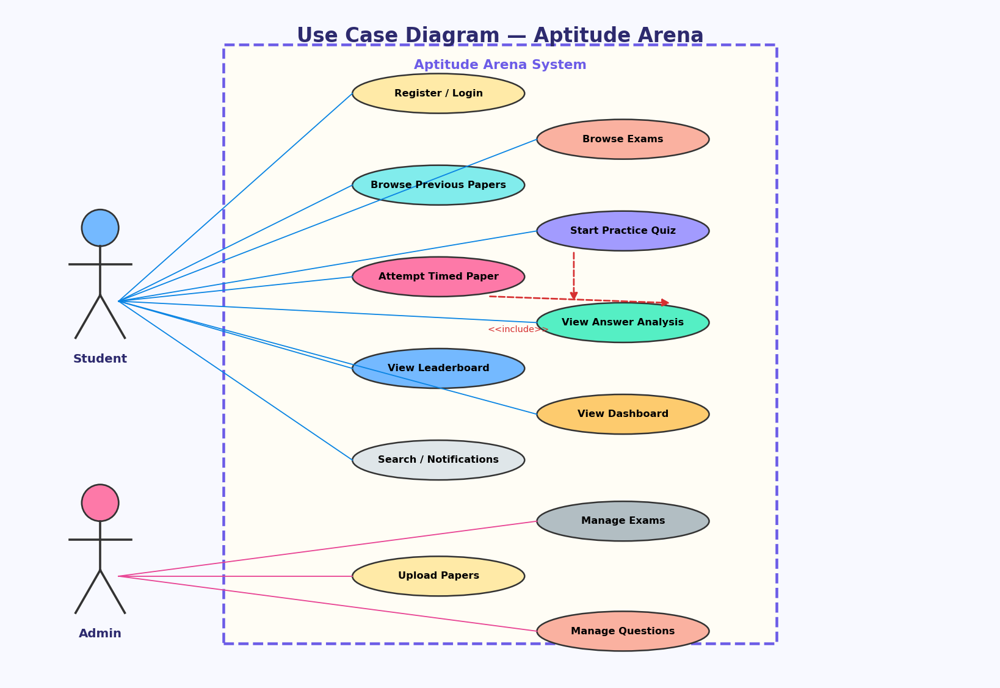
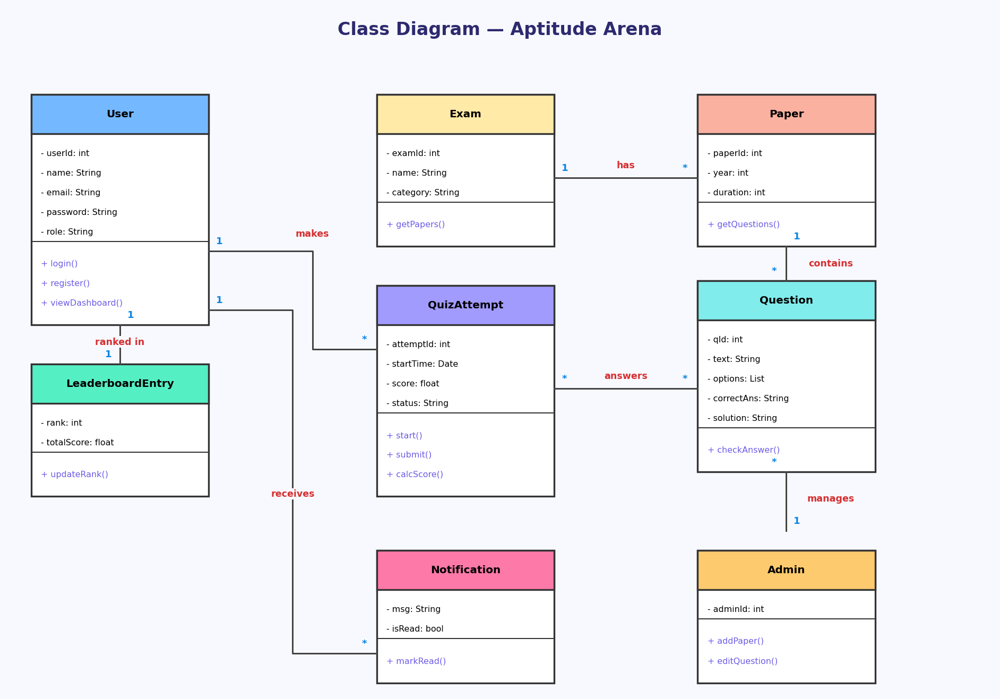
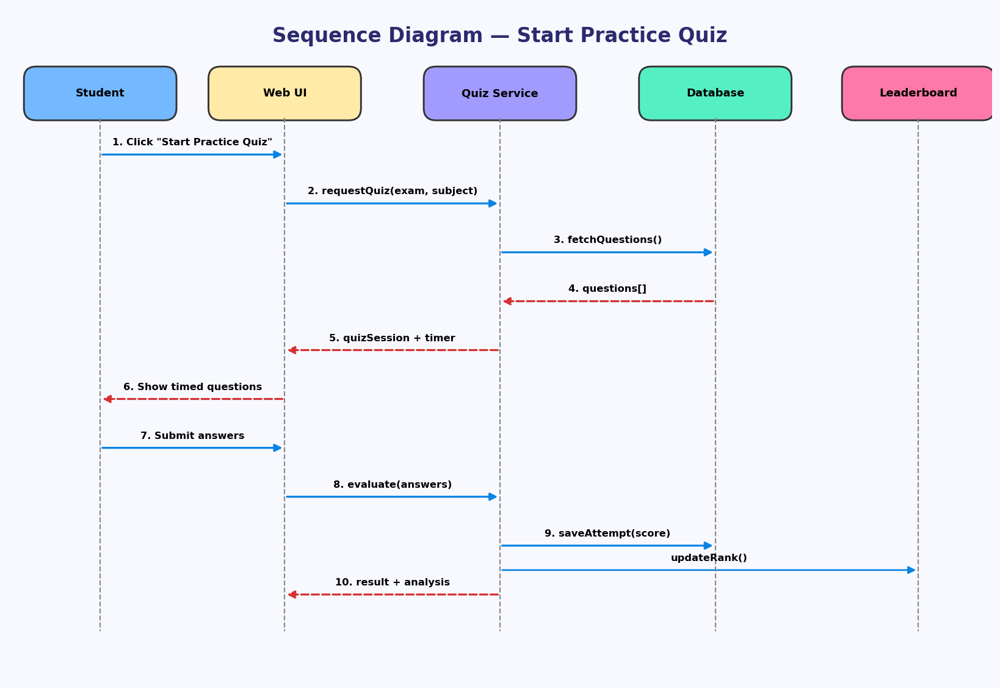
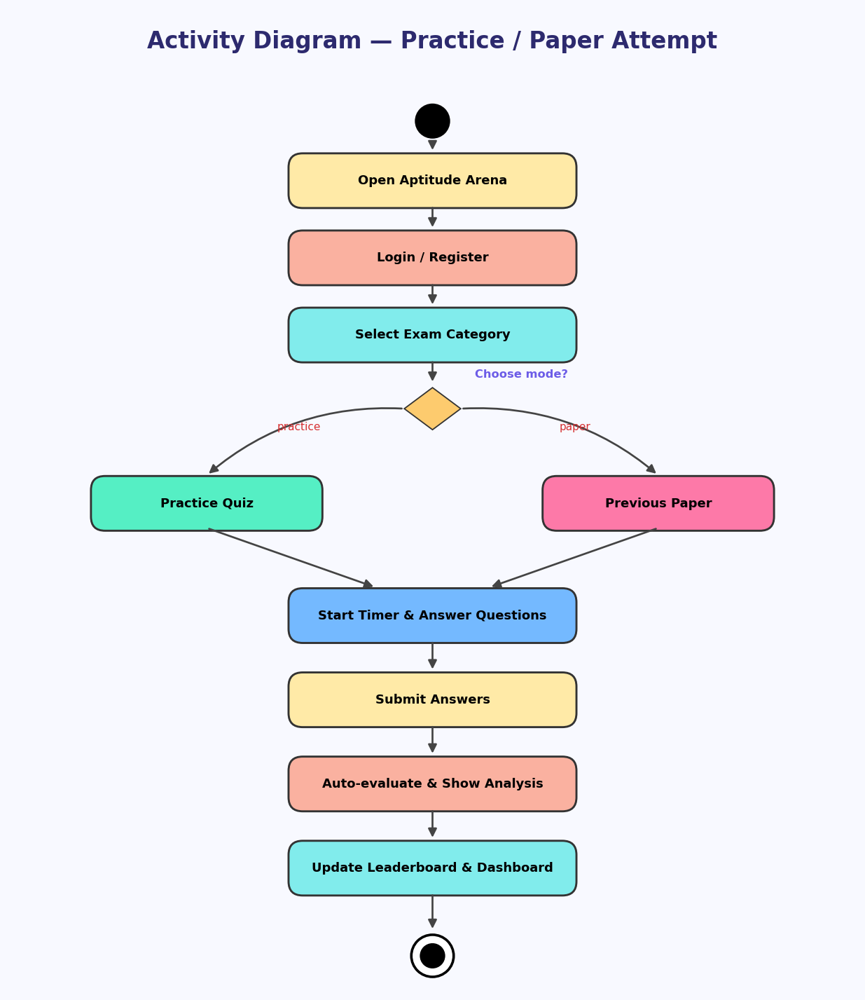
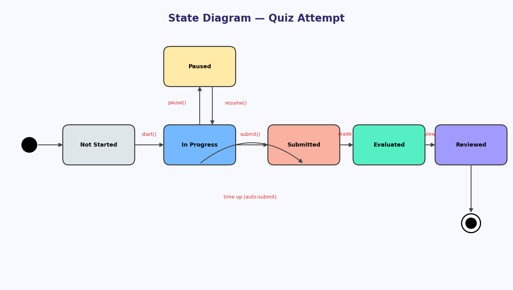
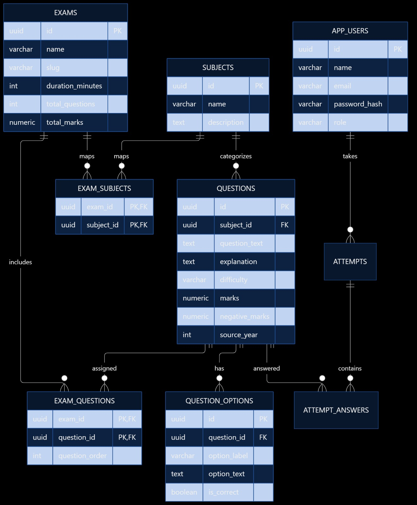
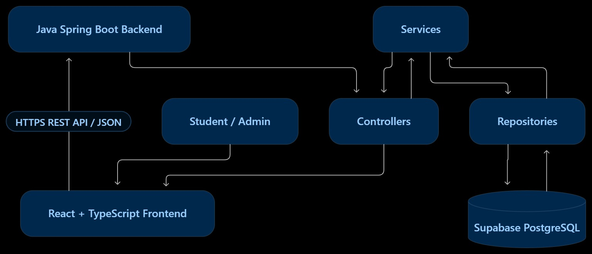
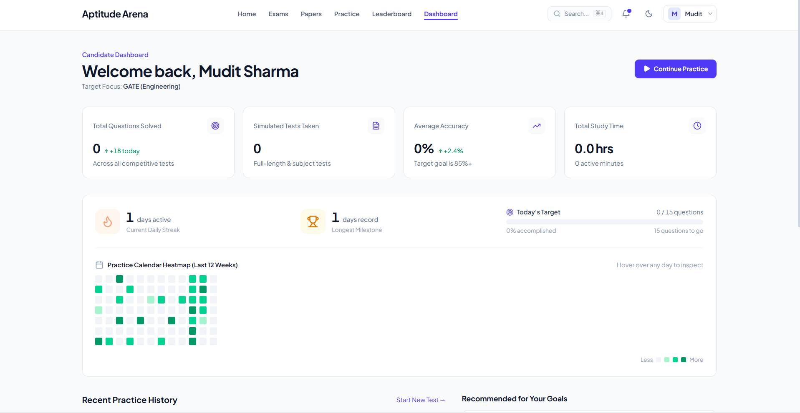
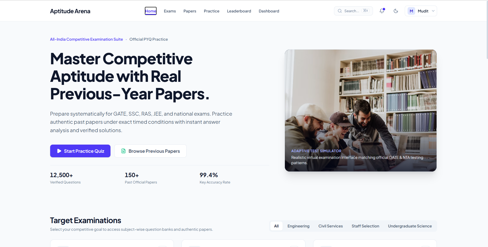

# Aptitude Arena
# week 1
📄 **Research Paper:** [View Aptitude Arena Research Paper (PDF)](https://github.com/MuditSharma670/Aptitude-Arena/blob/main/document.pdf?raw=true)

## Project Administration

* **Project Code:** PBL2627-CSE-B-037
* **Project Guide:** Er. Ram Babu Buri
  * **Research Area:** Machine Learning & Data Science
  * **Specializations:** Java, JSP–Servlet, Spring Boot, MySQL, Python
 
### Team Members

| Name | Roll No. | Enrollment No. | Email | Mobile |
| :--- | :--- | :--- | :--- | :--- |
| Krishna Veer Singh | 24EARCS078 | 24E1ARCSM40P078 | anshumansingh3960@gmail.com | 7300352263 |
| Kushagra Garg | 24EARCS081 | 24E1ARCSM40P081 | kushagrag2024@gmail.com | 8094724706 |
| Kartik | 24EARCS071 | 24E1ARCSM30PO71 | Kartikraria653@gmail.com | 9350802373 |
| Mudit Sharma | 24EARCS096 | 24E1ARCSM40P096 | ms.229.sharma@gmail.com | 9257254580 |
| Piyush Kumar | 24EARCS110 | 24E1ARCSM40P110 | piyish2005jadon@gmail.com | 8000593934 |


## Abstract

Modern e-learning infrastructures designed for high-stakes competitive examination preparation must simultaneously address complex technological, psychometric, and behavioral demands. Aptitude Arena is an advanced, web-based competitive examination practice platform engineered for candidates preparing for national assessments such as GATE, JEE, SSC, and State Public Service Commissions (e.g., RPSC RAS). Traditional online assessment platforms frequently suffer from static evaluation frameworks, network latency during high-concurrency exam events, and low long-term user engagement. Aptitude Arena addresses these challenges by integrating an interactive test simulator, verified Previous Year Question (PYQ) repositories, and continuous behavioral tracking.

The platform's underlying architecture leverages a high-performance Java Spring Boot backend paired with scalable microservices. It adopts a polyglot persistence strategy, utilizing PostgreSQL for ACID-compliant Identity and Access Management (IAM) and structured test metadata, alongside MongoDB for flexible, high-throughput storage of complex question banks and user response logs. To maintain low-latency synchronicity during live test events, the system incorporates WebSocket event-driven communication. Furthermore, an integrated Python microservice leverages Item Response Theory (IRT) algorithms to drive a Computerized Adaptive Testing (CAT) engine, dynamically calibrating question difficulty based on candidate performance.

Ultimately, Aptitude Arena unifies these architectural layers into an interactive Candidate Performance Dashboard. By combining real-time national leaderboards, daily streak tracking, and study activity heatmaps, the system employs behavioral habit-formation loops to maximize candidate consistency. This integration bridges the gap between raw testing and actionable psychometric evaluation, providing a secure, scalable, and adaptive testing ecosystem for competitive exam preparation.


# Week 2

## User Roles & Access Control
Aptitude Arena enforces strict authentication and role management at the API layer utilizing Spring Security and stateless JSON Web Tokens (JWT).
- **Student Candidate:** Can register/login, select from six competitive exam categories (GATE CSE, SSC CGL, RAS Rajasthan, JEE Main, CA Foundation, NEET UG), configure practice tests, submit responses, and view detailed scores and explanations.
- **System Administrator:** Possesses elevated privileges to manage examination catalogues, oversee question banks, monitor system health, and verify deployment metrics across backend APIs.

## SRS Document
You can access the Project SRS [https://1drv.ms/b/c/762dc0e747d4c238/IQCMhlrBCAvIS7UA2KdzgDIJAYt8shqe_3SUruQnmLF1ERM?e=VcytoV)
## Architecture & Core Modules
The Aptitude Arena architecture operates as a distributed full-stack system, with a Spring Boot Java backend acting as the core REST API provider, a React + TypeScript (Vite) interactive frontend client, and a Supabase PostgreSQL persistent database.

### Functional Modules & Team Responsibilities
- **Module 1: User Authentication and Profile Management (Member 1)**
  - **Focus:** Registration, login, identity and access security[cite: 57].
  - **Frontend:** Login page, registration page, authentication forms, login errors, and user profile interface[cite: 57].
  - **Backend:** `AuthController.java`, `AuthService.java`, `AppUserService.java`, JWT generation/validation, and `SecurityConfig.java`[cite: 57].
  - **Database:** `app_users` table, user IDs, email, password hash (BCrypt), and user role[cite: 57].

- **Module 2: Competitive Exam and Subject Management (Member 2)**
  - **Focus:** Exams, subjects, searching, and examination selection across 6 national categories[cite: 58].
  - **Frontend:** Exams page, exam cards, search and filters, and subject selection in practice modes[cite: 58].
  - **Backend:** `ExamController.java`, `ExamService.java`, `SubjectController.java`, and `SubjectService.java`[cite: 58].
  - **Database:** `exams`, `subjects`, and `exam_subjects` tables[cite: 58].

- **Module 3: Question Bank and Practice Engine (Member 3)**
  - **Focus:** MCQs, options, subject filtering, and practice session configuration (handling 600 original practice questions across exams)[cite: 59].
  - **Frontend:** `PracticePage.tsx`, question display, answer options, question count, and difficulty selection[cite: 59].
  - **Backend:** `QuestionController.java`, `QuestionService.java`, `QuestionRepository.java`, and `QuestionOptionRepository.java`[cite: 59].
  - **Database:** `questions`, `question_options`, and `exam_questions` tables[cite: 59].

- **Module 4: Test Attempts, Scoring and Results (Member 4)**
  - **Focus:** Test submission, answer evaluation, and score calculation[cite: 60].
  - **Frontend:** Submit confirmation modal, `QuizResultPage.tsx`, result display, correct/incorrect answers, and detailed explanations[cite: 60].
  - **Backend:** `AttemptController.java`, `AttemptService.java`, `AttemptAnswerService.java`, and attempt/result DTOs[cite: 60].
  - **Database:** `attempts` and `attempt_answers` tables[cite: 60].

- **Module 5: Dashboard, Leaderboard, Papers and Deployment Integration (Member 5)**
  - **Focus:** Connecting modules, cross-module integration, and operating the deployed application[cite: 61].
  - **Frontend:** Shared navigation and layout, `DashboardPage.tsx`, `LeaderboardPage.tsx`, `PapersPage.tsx`, `AdminPage.tsx`, and API integration[cite: 61].
  - **Backend:** Cross-module API integration, CORS configuration, performance verification, and security checks[cite: 61].
  - **Deployment & Hosting:** Google AI Studio (frontend) and Render (backend API)[cite: 41].

## Database Strategy (Supabase PostgreSQL)
The system utilizes Supabase PostgreSQL for robust, ACID-compliant relational data storage:
- **Core Tables:** `exams`, `subjects`, `questions`, `question_options`, `exam_subjects`, `exam_questions`, `app_users`, `attempts`, and `attempt_answers`.
- **Integration:** Connected via Spring Data JPA and Hibernate with secure environment-based configurations.

## Non-Functional Requirements
- **Performance:** Fast response times for question retrieval and test submission endpoints under standard student concurrent loads.
- **Security:** Password hashing via BCrypt, stateless JWT validation, global CORS configuration, and input sanitization.
- **Deployment & Accessibility:** Fully deployed online with live frontend and backend endpoints accessible for evaluation.
## week 3

### Project Diagrams

**1. Use Case Diagram**


**2. Class Diagram**


**3. Sequence Diagram**


**4. Activity Diagram**


**5. State Diagram**


**6. ER Diagram**


# Week 4: Database Design & System Architecture

## 1. Relational Database Schema & ER Design (Supabase PostgreSQL)
The platform utilizes a normalized relational database design to maintain data integrity and minimize redundancy across examination modules.

<div align="center">
  
</div>

<div align="center">
  
</div>

- **`exams` Table:** Stores metadata for national examinations (GATE, JEE, SSC, RAS, etc.) including title, slug, duration, total questions, and maximum marks.
- **`subjects` Table:** Categorizes domain subjects mapped to specific examinations.
- **`exam_subjects` Table:** Junction table managing the many-to-many relationship between exams and subjects.
- **`questions` Table:** Stores core question text, detailed step-by-step explanations, difficulty levels, allotted marks, negative marking rules, and source years.
- **`exam_questions` Table:** Maps specific questions to respective exam papers with custom question ordering.
- **`question_options` Table:** Holds multiple-choice options, option labels, option text, and correct answer flags for each question.
- **`app_users` Table:** Manages user accounts, secure email handles, BCrypt password hashes, and role-based permissions (Student / Admin).
- **`attempts` Table:** Records test session tracking, user IDs, linked exams, final computed scores, start timestamps, and submission timestamps.
- **`attempt_answers` Table:** Tracks individual candidate responses, selected options, and correctness flags per test attempt.

---

## 2. PostgreSQL Database DDL Queries (Supabase Setup)

Aap apne Supabase project ke SQL Editor mein in queries ko run karke complete schema setup kar sakte hain:

```sql
-- 1. EXAMS Table
CREATE TABLE exams (
    id UUID PRIMARY KEY DEFAULT gen_random_uuid(),
    name VARCHAR(255) NOT NULL,
    slug VARCHAR(255) UNIQUE NOT NULL,
    duration_minutes INT NOT NULL,
    total_questions INT NOT NULL,
    total_marks NUMERIC NOT NULL
);

-- 2. SUBJECTS Table
CREATE TABLE subjects (
    id UUID PRIMARY KEY DEFAULT gen_random_uuid(),
    name VARCHAR(255) NOT NULL,
    description TEXT
);

-- 3. EXAM_SUBJECTS Table (Mapping)
CREATE TABLE exam_subjects (
    exam_id UUID REFERENCES exams(id) ON DELETE CASCADE,
    subject_id UUID REFERENCES subjects(id) ON DELETE CASCADE,
    PRIMARY KEY (exam_id, subject_id)
);

-- 4. QUESTIONS Table
CREATE TABLE questions (
    id UUID PRIMARY KEY DEFAULT gen_random_uuid(),
    subject_id UUID REFERENCES subjects(id) ON DELETE CASCADE,
    question_text TEXT NOT NULL,
    explanation TEXT,
    difficulty VARCHAR(50),
    marks NUMERIC NOT NULL,
    negative_marks NUMERIC DEFAULT 0,
    source_year INT
);

-- 5. EXAM_QUESTIONS Table (Mapping)
CREATE TABLE exam_questions (
    exam_id UUID REFERENCES exams(id) ON DELETE CASCADE,
    question_id UUID REFERENCES questions(id) ON DELETE CASCADE,
    question_order INT,
    PRIMARY KEY (exam_id, question_id)
);

-- 6. QUESTION_OPTIONS Table
CREATE TABLE question_options (
    id UUID PRIMARY KEY DEFAULT gen_random_uuid(),
    question_id UUID REFERENCES questions(id) ON DELETE CASCADE,
    option_label VARCHAR(10) NOT NULL,
    option_text TEXT NOT NULL,
    is_correct BOOLEAN DEFAULT FALSE
);

-- 7. APP_USERS Table
CREATE TABLE app_users (
    id UUID PRIMARY KEY DEFAULT gen_random_uuid(),
    name VARCHAR(255) NOT NULL,
    email VARCHAR(255) UNIQUE NOT NULL,
    password_hash VARCHAR(255) NOT NULL,
    role VARCHAR(50) DEFAULT 'STUDENT'
);

-- 8. ATTEMPTS Table
CREATE TABLE attempts (
    id UUID PRIMARY KEY DEFAULT gen_random_uuid(),
    user_id UUID REFERENCES app_users(id) ON DELETE CASCADE,
    exam_id UUID REFERENCES exams(id) ON DELETE CASCADE,
    score NUMERIC,
    started_at TIMESTAMP DEFAULT CURRENT_TIMESTAMP,
    submitted_at TIMESTAMP
);

-- 9. ATTEMPT_ANSWERS Table
CREATE TABLE attempt_answers (
    id UUID PRIMARY KEY DEFAULT gen_random_uuid(),
    attempt_id UUID REFERENCES attempts(id) ON DELETE CASCADE,
    question_id UUID REFERENCES questions(id) ON DELETE CASCADE,
    selected_option_id UUID REFERENCES question_options(id),
    is_correct BOOLEAN
);

 ``` 

## 3. User Interface Previews

### C. Live Test Examination & Leaderboard Module
Interactive test-taking environment featuring real-time question navigation, countdown timers, negative marking calculations, and national performance leaderboards (`TIMER`, `NAVIGATOR`, `LEADERBOARD`).

- [Aptitude Arena Test Environment & Leaderboard]



<div align="center">
  
</div>


# Week 5: Backend REST APIs & Core Services Implementation
(Module 1 — Mudit Sharma)

This section details the core backend architecture, security configurations, and REST API endpoints developed for the platform.

## 1. Spring Boot Security & JWT Authentication
- Implement secure user registration and login endpoints with password hashing.
- **Endpoints:**
  - `POST /api/auth/register` — User signup (Student / Admin roles).
  - `POST /api/auth/login` — Generates JWT access token for authenticated sessions.

## 2. Exam & Question Retrieval Module
- Build controllers to fetch available examinations and their corresponding mapped questions.
- **Endpoints:**
  - `GET /api/exams` — Fetch list of all active national examinations (GATE, JEE, etc.).
  - `GET /api/exams/{examId}/questions` — Load exam questions securely without exposing correct answer flags to the frontend client.

## 3. Test Submission & Auto-Grading Engine
- Handle candidate test session submissions, evaluate responses against correct options, and calculate final scores with negative marking rules.
- **Endpoints:**
  - `POST /api/attempts/submit` — Receives candidate option choices, computes scores, stores results in Supabase `attempts` and `attempt_answers` tables, and returns detailed analytics.
```
aptitude-arena/
├── sql/
│   ├── 01_gate_cse_seed.sql
│   ├── 02_ssc_cgl_seed.sql
│   ├── 03_ras_rajasthan_seed.sql
│   ├── 04_jee_main_seed.sql
│   ├── 05_ca_foundation_seed.sql
│   └── 06_neet_ug_seed.sql
│
├── aptitude-arena-backend/
│   ├── pom.xml
│   └── src/
│       └── main/
│           └── java/com/aptitudearena/backend/
│               ├── controller/
│               │   ├── AttemptController.java
│               │   ├── AuthController.java
│               │   ├── ExamController.java
│               │   ├── HealthController.java
│               │   ├── QuestionController.java
│               │   └── SubjectController.java
│               ├── dto/
│               ├── entity/
│               ├── repository/
│               └── security/
│                   ├── JwtAuthenticationFilter.java
│                   ├── JwtService.java
│                   └── SecurityConfig.java
│
└── src/
    ├── assets/
    ├── components/
    │   └── cards/
    │       ├── ExamCard.tsx
    │       ├── PaperCard.tsx
    │       └── QuestionCard.tsx
    ├── context/


    ├── pages/
    └── services/

```
# Week 6: Advanced Analytics, Leaderboards & Admin Management Modules

## 1. Team Member Contributions
### • Member 2: [Piyush]
- **Leaderboard & Performance Analytics Module:** Developed backend calculation engines and APIs to rank users nationally, track attempt history, and compute accuracy and score metrics.
- **Analytics Integration:** Built backend services to support user progress tracking, score summaries, and historical performance comparisons.

### • Member 3: [Kushagra Garg]
- **Admin Exam & Question Management Module:** Implemented secure administrative REST APIs and controllers for managing exams, subjects, question banks, and answer keys.
- **Content Operations Support:** Facilitated backend validation for dynamic question creation, option mapping, and database seed oversight.

---

## 2. Week 6 REST API Endpoints & Core Services

### A. Member 2: Leaderboard & Analytics Module
* **`GET /api/leaderboard/{examId}`** — Fetches the top-ranked candidates and performance metrics for a specific national examination.
* **`GET /api/attempts/user/{userId}`** — Retrieves a candidate's complete history of test attempts, scores, and timestamps.
* **`GET /api/analytics/summary/{userId}`** — Computes overall statistics including total tests taken, average accuracy, and total questions solved.

### B. Member 3: Admin Question & Exam Management Module
* **`POST /api/admin/exams`** — Allows administrators to create new national examination suites with custom durations and total marks.
* **`POST /api/admin/questions`** — Secure endpoint for admins to add new questions, detailed explanations, and multiple-choice options with correct flags.
* **`PUT /api/admin/questions/{questionId}`** — Updates existing question text, difficulty levels, or allotted marks.
* **`DELETE /api/admin/exams/{examId}`** — Removes outdated examination records and cascades dependent question mappings.

---

## 3. Project Directory Structure Update (Week 6 Additions)

```text
aptitude-arena-backend/
└── src/
    └── main/
        └── java/com/aptitudearena/backend/
            ├── controller/
            │   ├── LeaderboardController.java  # Member 2: National rankings & score stats
            │   ├── AnalyticsController.java    # Member 2: Candidate attempt history & summary
            │   └── AdminExamController.java    # Member 3: Admin CRUD for exams & questions
            └── service/
                ├── LeaderboardService.java     # Leaderboard calculation business logic
                ├── AnalyticsService.java       # User performance data aggregation
                └── AdminService.java           # Administrative content management logic


```
# Week 7: Frontend Exam Simulator, Real-time Timer & Result Analytics Module

## 1. Team Member Contributions

### Member 4: [Kartik]

- **Interactive Test Simulator UI:** Developed the real-time exam-taking interface featuring question navigation palettes, status markers (Answered, Marked for Review, Unanswered), and bookmarking.
- **Timer & Auto-Submission Logic:** Implemented synchronized countdown timers with local state persistence and automatic form submission upon time expiry.
- **Result & Analytics Dashboard:** Built client-side visualization components to display score breakdowns, negative marking summaries, and detailed question-wise explanations.

---

## 2. Week 7 Frontend Components & Services

- **`ExamSimulator.tsx`:** Main container managing active test states, question switching, and event handlers. 
- **`QuestionPalette.tsx`:** Interactive grid showing question statuses for quick navigation.
- **`TimerDisplay.tsx`:** Handles real-time countdown tracking, visual warnings for low time, and auto-submission.
- **`ResultPage.tsx`:** Displays post-test analytics, total computed score, accuracy percentage, and correct/incorrect answers review.

---

## 3. Project Directory Structure Update (Week 7 Additions)

```text
aptitude-arena/
└── src/
    ├── components/
    │   ├── exam/
    │   │   ├── ExamSimulator.tsx
    │   │   ├── QuestionPalette.tsx
    │   │   └── TimerDisplay.tsx
    │   └── results/
    │       ├── ScoreCard.tsx
    │       └── SolutionReview.tsx
    └── pages/
        ├── ResultPage.tsx
        └── PracticePage.tsx
```
# Week 8
## 5. Member 5: Moderator Dashboard & Platform Governance
## Role & Scope of Work
## Member 5 built the administrative control center, ensuring platform compliance, user access management, and content quality control.

**`Frontend (User Interface & State)`:** Built an administrative management portal with reported content queues, user management tables, article review panels, role-assignment toggles, and system metrics widgets.
**`Backend (API Logic)`:** Enforced strict Role-Based Access Control (RBAC) security filters (ensuring only verified administrative tokens can execute privileged actions), developed moderation management APIs, and built audit logging services.
**`Database & Governance`:** Designed database tables to record user roles, security mappings, flag reports, and moderation action history logs.
Problems & Challenges Faced
**`Privilege Escalation Risks`:** Ensuring security filters prevented regular users from forging tokens or tricking parameters to access admin controllers.
**`Bulk Action Transaction Safety`:** Moderating or hiding multiple spam posts simultaneously without locking database collections or breaking search indexes.
**`Real-Time UI State Sync`:** Ensuring that when content is flagged or hidden by a moderator, the change immediately reflects on the live public feeds without leaving broken or dead links for readers.
What They Completed
A complete Moderation & Administrative Portal for community governance.
Role-Based Access Control (RBAC) security configuration for endpoints and UI views.
Content flagging workflow, user suspend/promote features, and immutable admin action audit logs.
Summary of Module Distribution
Module	Team Member Scope	Primary Focus	Key Deliverable
1. Home Page	End-to-End	Feeds, Search, Filtering, Caching	Public Feed, Search Engine, Indexing
2. Editor / Article Writing	End-to-End	WYSIWYG/Markdown, Sanitization, Drafts	Content Writer, Auto-save Engine
3. User Profile / Portfolio	End-to-End	Identity, Aggregation, Third-Party APIs	Live Developer Portfolio, GitHub Integration
4. Moderator Dashboard	End-to-End	RBAC Security, Content Flags, Admin Logs	Governance Portal, Access Controls
5. AI Functionality	End-to-End	LLM Microservice, Text Parsing, Async Jobs	Automated Summarizer, Smart Tag Generator

# Week 9: Test Submission, Results & Dashboard Integration

This phase connects the practice-test workflow with answer evaluation and the results interface. The objective is to ensure that the user can attempt questions, submit a test, and review the outcome through the integrated application.

## 1. Team Member Contributions

### Member 1: Authentication and Profile Management
- Verified that authentication and user-session handling remained consistent while navigating between application pages.
- Reviewed access to features that require authentication.

### Member 2: Exam and Subject Management
- Integrated the selected examination and subject information with the practice workflow.
- Checked that the correct examination details were maintained during test navigation.

### Member 3: Question Bank and Practice Engine
- Verified question retrieval and the display of MCQ options.
- Checked question selection, answer recording, and the transition from practice to submission.

### Member 4: Test Attempts, Scoring and Results
- Integrated the test-submission confirmation flow with the results interface.
- Checked score display, answer review, and explanations.

### Member 5: Dashboard and System Integration
- Connected navigation between the examination, practice, dashboard, and results sections.
- Reviewed frontend-backend integration and the consistency of API responses.

## 2. Problems Faced

- The submission flow required debugging after backend integration.
- API responses and frontend navigation needed to remain consistent during test completion.
- Question selection and result display needed verification across different exam categories.

## 3. What Was Completed

- Integrated the practice-test submission flow and results interface.
- Connected the frontend with the Java Spring Boot backend.
- Verified exam and question retrieval through the available APIs.
- Reviewed the user workflow from question selection through submission and result display.

**Next Week:** Perform complete system integration testing, fix remaining defects, and optimize API performance.

---

# Week 10: System Integration, Testing and Performance Optimization

This phase focuses on testing the integrated application and resolving issues across the React frontend, Spring Boot backend, and Supabase PostgreSQL database.

## 1. Team Member Contributions

### Member 1: Authentication Testing
- Checked registration and login flows.
- Reviewed authentication failures and access restrictions.

### Member 2: Exam and Subject Testing
- Verified exam and subject retrieval.
- Checked examination selection and exam-subject mappings.

### Member 3: Question Bank Testing
- Validated question retrieval and answer-option structure.
- Checked available questions, subject filters, and practice-test configuration.

### Member 4: Submission and Results Testing
- Tested submission, score display, and answer review.
- Checked consistency between submitted responses and displayed results.

### Member 5: Integration and Performance Testing
- Tested frontend-backend communication and production API responses.
- Investigated connectivity, authorization, and response-time issues.

## 2. Problems Faced

- Some API requests experienced authorization or connectivity errors.
- Question retrieval was initially slow.
- Integration changes required regression testing to ensure that existing features continued working.

## 3. What Was Completed

- Tested examination retrieval, subject selection, question loading, submission, and results.
- Improved question API performance during local testing: the measured response time decreased from approximately 41.2 seconds to 0.64 seconds.
- Reviewed error handling and the consistency of API responses.
- Prepared the application for production deployment.

**Next Week:** Deploy the application, review security configuration, and prepare the final project report, presentation, and demonstration video.

---

# Week 11: Cloud Deployment and Security Verification

📄 **Research Paper:** [View Official Project Document Online](./document.pdf)

This phase focuses on making Aptitude Arena accessible online and verifying the production configuration.

## 1. Team Member Contributions

### Member 1: Authentication and Security
- Reviewed JWT configuration and authentication behaviour.
- Checked that signing secrets were kept in environment variables rather than frontend code.

### Member 2: Exam API Deployment Verification
- Verified that the deployed examination API returned the expected JSON response.
- Checked exam and subject retrieval using the public backend endpoint.

### Member 3: Question Bank Verification
- Reviewed the question-bank records and exam-question mappings.
- Checked that the deployed backend could retrieve stored practice data.

### Member 4: Test and Results Verification
- Reviewed the practice-test submission and results workflow.
- Identified any remaining production issues requiring correction.

### Member 5: Deployment and Documentation
- Prepared the backend deployment copy and uploaded it to GitHub.
- Deployed the Java Spring Boot backend on Render.
- Reviewed environment-variable configuration and prepared supporting project documentation.

## 2. Problems Faced

- Database connection settings and JWT environment variables needed correct production configuration.
- The first deployment encountered startup configuration errors that required troubleshooting.
- The published frontend and public backend needed to use the correct production API URL.

## 3. What Was Completed

- Deployed the Spring Boot backend on Render.
- Verified that the public `/api/exams` endpoint returned HTTP 200 and examination records.
- Published the frontend through Google AI Studio.
- Prepared the project report, presentation, and demonstration materials.

**Next Week:** Perform final public-site testing, prepare demonstration evidence, and conduct the project viva.

---

# Week 12: Final Testing, Project Demonstration and Viva

This final phase verifies the application as a complete system and prepares the team to demonstrate its functionality and technical architecture.

## 1. Team Member Contributions

### Member 1: Authentication Demonstration
- Demonstrates the authentication flow and explains user access control.
- Explains the relevant frontend, backend, and database components.

### Member 2: Examination Catalogue Demonstration
- Demonstrates examination selection and subject retrieval.
- Explains the exam and subject APIs and their database relationships.

### Member 3: Question Bank Demonstration
- Demonstrates MCQ retrieval and the practice interface.
- Explains the question and option tables and question-retrieval APIs.

### Member 4: Test Submission and Results Demonstration
- Demonstrates completing and submitting a practice test.
- Explains answer evaluation, score display, and the related backend services.

### Member 5: Integration and Deployment Demonstration
- Demonstrates the published website and live backend API.
- Explains the system architecture, deployment configuration, and integration testing.

## 2. Problems Faced

- The final deployment required verification of frontend-backend connectivity.
- The team needed to ensure that demonstrated features matched their actual implementation.
- Project documentation and supporting evidence needed to be organized for the final evaluation.

## 3. What Was Completed

- Reviewed the published application and its principal user workflows.
- Verified the live exam API and the retrieval of examination records.
- Prepared the project overview, technical explanations, and demonstration sequence.
- Organized the frontend and backend repositories and the project documentation for evaluation.

## Final Project Outcome

Aptitude Arena demonstrates a full-stack competitive examination practice platform built with React and TypeScript, Java Spring Boot REST APIs, and Supabase PostgreSQL. The application includes six examination categories and 600 generated practice questions, with an integrated workflow for question practice, test submission, and results review.

**Live Website:** https://aptitude-arena.ai.studio/

**Frontend Repository:** https://github.com/rkrishnaveersingh/aptitude-arena

**Backend Repository:** https://github.com/rkrishnaveersingh/aptitude-arena-backend-render

**Live Backend API:** https://aptitude-arena-backend-render.onrender.com/api/exams

*Note: Replace module responsibilities or completion statements where necessary so the README accurately reflects the work actually performed by each team member. Generated practice questions should not be described as verified official previous-year questions.*
                                             │
                                             ▼
[Visible on User Portfolio (Mem 3)] <─── [Subject to Mod Controls (Mem 4)]
By dividing integration testing by architectural responsibility, the team successfully transformed five independently built modules into a secure, high-performance, and resilient developer platform.

